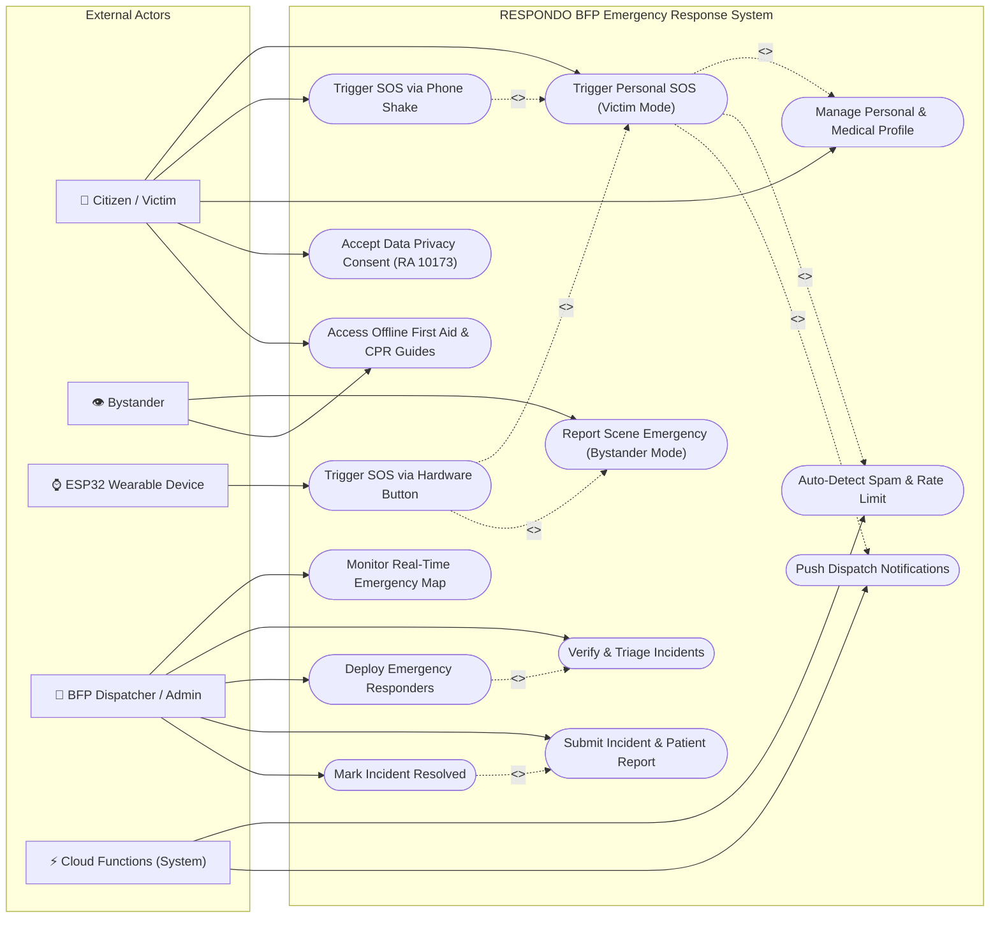
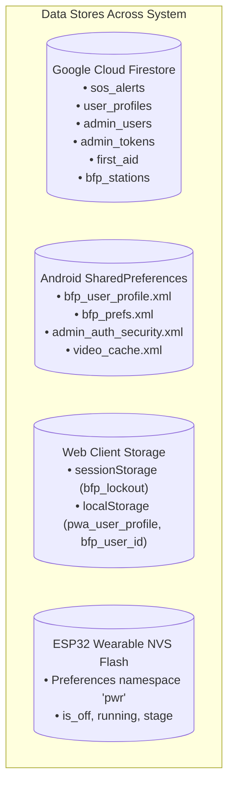
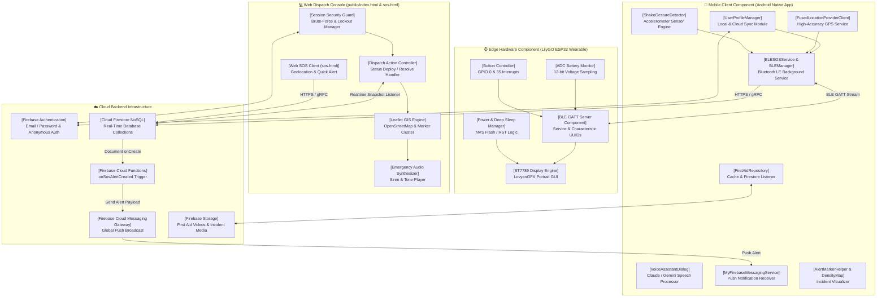
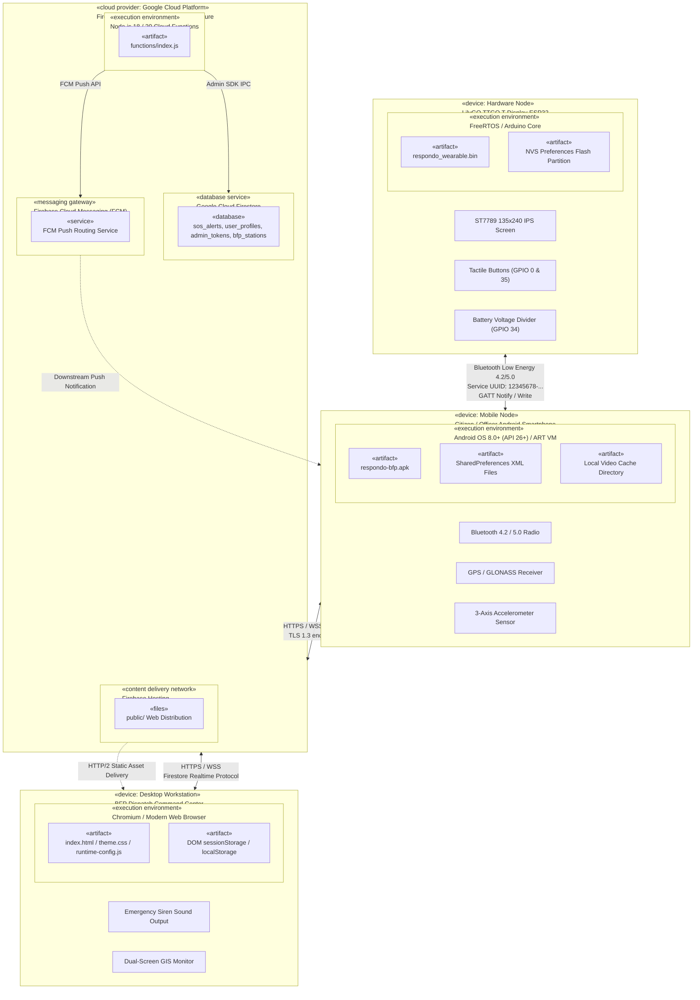
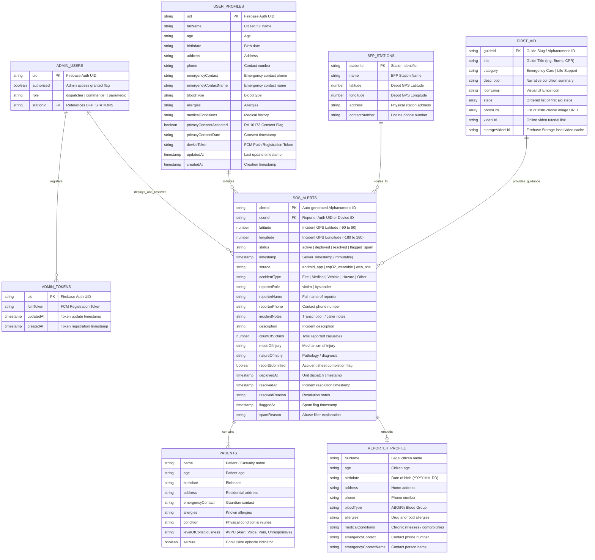
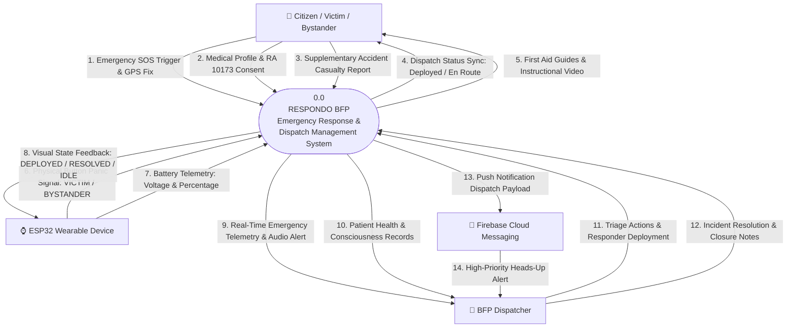

# RESPONDO BFP — Systems Analysis and Design (SAD) Specification

**System Name:** RESPONDO BFP Emergency Response & Dispatch Management System  
**Document Type:** Systems Analysis and Design (SAD) Deliverable  
**Version:** 2.0  
**Scope:** End-to-End System (Hardware Wearable Device, Android Mobile App, Web Dispatch Dashboard, Firebase Cloud Infrastructure)

---

## Table of Contents
1. [Use Case Diagram & System Specifications](#1-use-case-diagram)
2. [Data Dictionary](#2-data-dictionary)
3. [Component Diagram](#3-component-diagram)
4. [Deployment Diagram](#4-deployment-diagram)
5. [Database Diagram (Entity-Relationship Diagram - ERD)](#5-database-diagram-erd)
6. [Data Flow Diagrams (DFD Level 0 & Level 1)](#6-data-flow-diagrams-dfd)

---

## 1. Use Case Diagram

The Use Case Diagram defines the operational interactions between external actors (Citizens, Bystanders, Wearable Hardware, BFP Dispatchers, and Automated Cloud Processes) and the Respondo BFP software platform.



### Use Case Specifications

| Use Case ID | Name | Primary Actor | Description | Preconditions | Postconditions |
| :--- | :--- | :--- | :--- | :--- | :--- |
| **UC-01** | Trigger Personal SOS | Citizen / Victim | Dispatches instant panic signal with GPS coordinates and victim medical profile. | Location enabled on smartphone. | Active emergency document created in Firestore; dispatchers alerted. |
| **UC-02** | Report Scene Emergency | Bystander | Eyewitness reports fire, vehicular accident, or medical hazard without attaching personal medical history. | Network or cellular connection active. | Scene incident created with `reporterRole: "bystander"`. |
| **UC-03** | Trigger via Wearable | ESP32 Wearable | User clicks physical Right Button (Victim) or Left Button (Bystander) on wrist accessory. | Wearable paired over Bluetooth Low Energy (BLE). | Android service reads BLE packet and initiates mobile SOS pipeline. |
| **UC-04** | Trigger via Shake | Citizen | User vigorously shakes phone in emergency situations where screen access is restricted. | Accelerometer enabled; shake threshold reached ($> 2.7\text{G}$). | Emergency countdown triggered, followed by automated dispatch. |
| **UC-05** | Manage Medical Profile | Citizen | Registers blood type, allergies, pre-existing conditions, and emergency contacts. | User authenticated or in local profile view. | Saved locally and synchronized to `/user_profiles/{uid}` in cloud. |
| **UC-08** | Monitor Emergency Map | BFP Dispatcher | Live GIS dashboard displaying emergency alerts with dynamic visual indicators and sirens. | BFP admin credentials verified. | Dispatcher views real-time markers with hazard type and caller information. |
| **UC-10** | Deploy Responders | BFP Dispatcher | Assigns fire trucks or paramedics; draws route polyline from BFP station to incident GPS. | Alert is in `active` state. | Alert transitions to `deployed`; wearable screen switches to "Responders En Route". |
| **UC-12** | Resolve Emergency | BFP Dispatcher | Closes emergency after scene is neutralized or victims transported. | Alert in `deployed` state. | Alert status set to `resolved`; wearable returns to standby. |
| **UC-13** | Spam Abuse Limiting | Cloud Functions | Evaluates incoming frequency per device. Automatically flags duplicate alerts $> 3$ in 60 seconds. | Incident created in Firestore. | Alert marked `flagged_spam` if limit exceeded; prevents dispatcher alarm fatigue. |

---

## 2. Data Dictionary

The full, exhaustive field-level data dictionary covering all database entities, client storage, hardware registers, and communication payloads is maintained in [DATA_DICTIONARY.md](file:///c:/Users/Alvin%20Jan/project/sad/respondo-bfp-app/DATA_DICTIONARY.md). Below is the comprehensive structural summary across all system components.

### 2.1 Multi-Tier Data Storage Summary



### 2.2 Core Firestore Collections Specification

| Entity / Collection | Document ID | Key Fields | Cardinality / Relationships | Purpose |
| :--- | :--- | :--- | :--- | :--- |
| **`sos_alerts`** | Auto-ID (20 chars) | `userId`, `latitude`, `longitude`, `status`, `timestamp`, `accidentType`, `reporterRole`, `reporterProfile`, `patients`, `deployedAt`, `resolvedAt` | $1 : N$ with `patients`, $1 : 1$ with embedded `reporterProfile` | Primary emergency dispatch record. Enforces immutability on core telemetry. |
| **`user_profiles`** | User `uid` | `fullName`, `phone`, `bloodType`, `allergies`, `medicalConditions`, `emergencyContact`, `privacyConsentAccepted`, `updatedAt` | $1 : 1$ with Firebase Auth Account | Pre-filled medical triage identity and legal compliance record under RA 10173. |
| **`admin_users`** | Admin `uid` | `authorized` (`bool`), `role` (`string`), `stationId` (`string`) | $1 : 1$ with BFP Personnel Account | Role-Based Access Control (RBAC) whitelist for BFP dispatchers and officers. |
| **`admin_tokens`** | Admin `uid` | `fcmToken`, `updatedAt`, `createdAt` | $1 : 1$ with Admin Device | Registered Firebase Cloud Messaging push endpoints for dispatch sirens. |
| **`first_aid`** | Alphanumeric ID | `title`, `category`, `description`, `iconEmoji`, `steps` (array), `photoUrls` (array), `videoUrl`, `storageVideoUrl` | Standalone reference repository | Medical emergency protocols available offline on mobile and online on web. |
| **`bfp_stations`** | Station ID | `name`, `latitude`, `longitude`, `address`, `contactNumber` | $1 : N$ with Dispatched Alerts | Coordinates of fire stations used for routing and distance calculation. |

---

## 3. Component Diagram

The Component Diagram details the structural modules, dependencies, and interfaces connecting the Android Native Application, ESP32 Firmware, Web Dispatch Console, and Google Cloud Backend.



---

## 4. Deployment Diagram

The Deployment Diagram models the physical runtime nodes, execution environments, hardware specifications, and network protocols connecting edge devices, client terminals, and cloud infrastructure.



---

## 5. Database Diagram (ERD)

The Entity-Relationship Diagram outlines all collections, embedded complex structures, primary keys, foreign keys, cardinality, and field attributes.



---

## 6. Data Flow Diagrams (DFD)

### 6.1 DFD Level 0 — System Context Diagram
The Level 0 Context Diagram establishes the global boundary of the RESPONDO BFP system, displaying data inflows and outflows between external entities and the central emergency system.



---

### 6.2 DFD Level 1 — Subsystem Decomposition Diagram
The Level 1 Diagram decomposes the central system into six distinct operational processes, showing internal data transformations and interactions with Firestore data stores.

```mermaid
flowchart TD
    %% External Entities
    Citizen["🧑 Citizen / Bystander"]
    Wearable["⌚ ESP32 Wearable"]
    Dispatcher["🚒 BFP Dispatcher"]
    FCM_GW["📡 FCM Push Service"]

    %% Processes
    P1(["1.0\nPanic Signal &\nTelemetry Intake"])
    P2(["2.0\nValidation & Spam\nAbuse Filter"])
    P3(["3.0\nIncident Triage &\nGIS Route Mapping"])
    P4(["4.0\nResponder Deployment\n& Status Broadcast"])
    P5(["5.0\nCasualty Reporting &\nIncident Resolution"])
    P6(["6.0\nProfile & First Aid\nKnowledge Mgmt"])

    %% Data Stores
    D1[("D1: sos_alerts")]
    D2[("D2: user_profiles")]
    D3[("D3: admin_users")]
    D4[("D4: bfp_stations")]
    D5[("D5: first_aid")]
    D6[("D6: admin_tokens")]

    %% Process 1.0 Flows
    Wearable -->|BLE Button Trigger: VICTIM / BYSTANDER| P1
    Citizen -->|Mobile SOS / Shake / Web SOS + GPS| P1
    D2 -.->|Read victim medical profile| P1
    P1 -->|Generate draft emergency document| P2

    %% Process 2.0 Flows
    P2 -->|Rate limit check <= 3 per 60s| P2
    P2 -->|Write verified active alert| D1
    P2 -->|Write flagged_spam record if violated| D1
    P2 -->|Dispatch trigger payload| FCM_GW
    D6 -.->|Read admin registration tokens| FCM_GW

    %% Process 3.0 Flows
    D1 -.->|Real-time snapshot stream| P3
    D4 -.->|Read BFP station coordinates| P3
    D3 -.->|Verify dispatcher authentication| P3
    P3 -->|Render map marker, hazard color & route polyline| Dispatcher

    %% Process 4.0 Flows
    Dispatcher -->|Action: Deploy Emergency Unit| P4
    P4 -->|Update status: 'deployed', deployedAt: serverTimestamp| D1
    P4 -->|Broadcast STATUS:DEPLOYED over BLE| Wearable
    P4 -->|Sync 'Responders En Route' status to citizen UI| Citizen

    %% Process 5.0 Flows
    Dispatcher -->|Submit casualty status & AVPU vitals| P5
    Citizen -->|Submit supplementary accident sheet| P5
    P5 -->|Update patients[] array & reportSubmitted: true| D1
    Dispatcher -->|Action: Resolve incident + enter notes| P5
    P5 -->|Update status: 'resolved', resolvedAt: serverTimestamp| D1
    P5 -->|Broadcast STATUS:RESOLVED over BLE| Wearable

    %% Process 6.0 Flows
    Citizen -->|Edit medical conditions, blood type, allergies| P6
    P6 -->|Save citizen profile & privacy consent| D2
    Citizen -->|Query CPR & emergency guides| P6
    D5 -.->|Read first aid steps & cached video URLs| P6
    P6 -->|Deliver first aid instructions| Citizen
```

---

## 7. Verification and Traceability Matrix

| Requirement / Component | Use Case | Data Dictionary Store | Component | Deployment Node | ERD Entity | DFD Process |
| :--- | :---: | :---: | :---: | :---: | :---: | :---: |
| **Wearable SOS Trigger** | UC-03 | `esp32_wearable` NVS & BLE | `BLE_SERVER` & `BLE_SVC` | `Node_ESP32` | `SOS_ALERTS` | Process 1.0 |
| **Shake to Emergency** | UC-04 | `bfp_prefs.xml` (`pref_shake`) | `SHAKE_DET` | `Node_Android` | `SOS_ALERTS` | Process 1.0 |
| **Victim Medical Profile**| UC-05, UC-06 | `user_profiles`, `bfp_user_profile`| `USER_MGR` | `Node_Android` | `USER_PROFILES`, `REPORTER_PROFILE` | Process 6.0 |
| **Spam Rate Limiter** | UC-13 | `sos_alerts.status: flagged_spam` | `CLOUD_FUNC` | `Node_Cloud` | `SOS_ALERTS` | Process 2.0 |
| **FCM Audio Siren** | UC-14 | `admin_tokens` | `FCM_SVC` & `AUDIO_CTRL` | `Node_PC` / `Node_Android`| `ADMIN_TOKENS` | Process 2.0 |
| **GIS Map & Station Route**| UC-08, UC-10 | `bfp_stations`, `sos_alerts` | `WEB_MAP`, `MAP_MARKER` | `Node_PC` | `BFP_STATIONS` | Process 3.0 |
| **Casualty Triage Sheet** | UC-11 | `sos_alerts.patients[]` | `DISPATCH_MGR` | `Node_Android` / `Node_PC`| `PATIENTS` | Process 5.0 |
| **Offline First Aid** | UC-07 | `first_aid`, `video_cache` | `FIRST_AID_REPO` | `Node_Android` | `FIRST_AID` | Process 6.0 |
